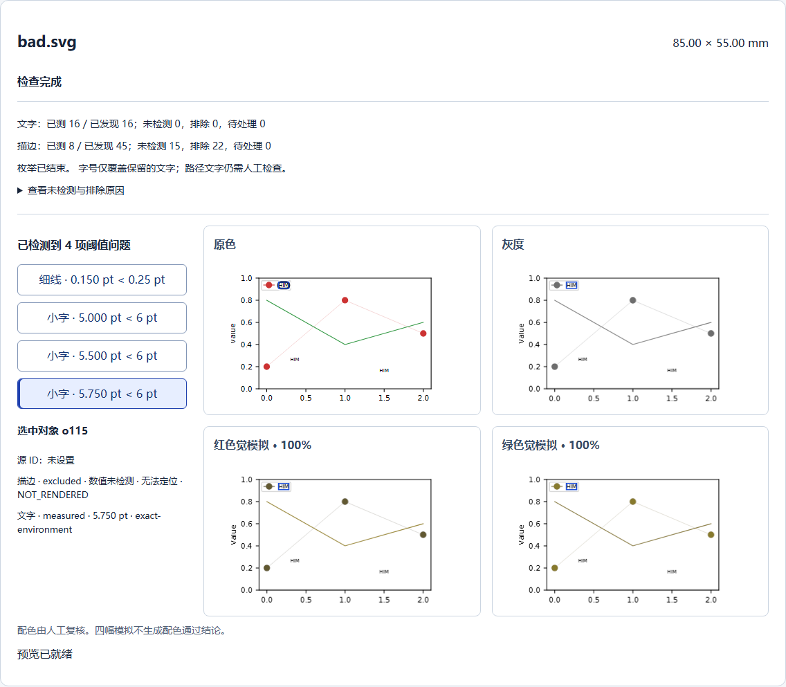

# FigurePreflight

### Local SVG checks for publication-size figures

**Check retained text sizes and stroke widths at your final figure width, locate findings in four linked previews, and save an offline HTML report plus structured JSON.**

English | [中文](README_ZH.md)

[Run locally](#run-locally) · [Try the example](#try-the-85-mm-example) · [Support and limits](docs/support.md) · [Example HTML](examples/bad-85mm.html) · [Example JSON](examples/bad-85mm.json)



Actual report from the synthetic 85 mm example: three small text objects and one thin line, with the legend selected across all four previews.

## Run locally

Use Node.js **24.15.0**. Install development packages and build once:

```sh
npm ci
npm run build
npm run serve
```

Open `http://127.0.0.1:48626`. The server serves only its generated asset allowlist on loopback. Your SVG stays in the browser. A built distribution needs Node only; Python and browser installation below are for fixture generation and development tests.

## Try the 85 mm example

1. Click the 85 mm example, or import [bad.svg](examples/bad.svg). Keep thresholds at **6 pt text / 0.25 pt stroke**.
2. The example reports three small text objects, including a real Matplotlib legend, and one thin line. Select a finding or a figure object to highlight it in all four views. Enter/Space selects a focused object.
3. Set the text threshold to **5.6 pt**: two text findings remain, plus the line. Threshold changes reuse the saved measurement. Changing width to **170 mm** creates a new measurement revision.
4. Restore **85 mm / 6 pt** and import [fixed.svg](examples/fixed.svg). The four corresponding issues disappear.
5. Compare original, grayscale, protanopia and deuteranopia previews. Record viewing conditions and your own color judgment. Save JSON or, once previews are ready, HTML. HTML includes figure content and can be reopened offline.

The demonstration uses synthetic data. On a default-scale desktop display, red and green series become close in grayscale; line styles and labels help distinguish them. This is an inspection note, not an automated color-accessibility verdict. Simulations use the published Machado model at severity 100% and a linear-light grayscale model.

## Export text from Matplotlib

```python
import matplotlib as mpl
import matplotlib.pyplot as plt
mpl.rcParams["svg.fonttype"] = "none"
fig, ax = plt.subplots()
ax.plot([0, 1, 2], [1, 3, 2], label="HIM")
ax.legend()
fig.savefig("figure.svg", metadata={"Date": None})
```

Inputs are capped at 2 MiB, 4,096 elements, 4,096 raw path commands, 1,024 commands per geometry sequence and 2,048 expanded commands. Actual viewport pixels times conservative draw weight must stay within 128 million. Oversized work returns `limited`; reducing the final width can restore previews. See the complete [limits](docs/support.md).

The supported profile is `matplotlib-text-svg-v1`. Path-converted letters have no recoverable text size here. Export with retained text before checking.

## What the report means

Text and stroke findings apply only to measured objects. The report separately preserves discovered, measured, unassessed, excluded and pending counts. Complete execution does not mean the figure passed every check. Unsupported visual features disable all previews and measurements rather than show an altered figure. Missing fonts, unsupported transforms or units may make numeric values or positions unknown; their reasons remain visible.

Trusted normal DejaVu Sans 2.35 glyphs have verified font bytes and environment-specific positions. Other fonts, missing glyphs and non-normal styles keep their browser fallback appearance with downgraded positions. The saved three simulation images preserve that run; the original SVG may render fallback fonts differently on another machine. Chromium screen text can use LCD antialiasing while the simulation raster uses grayscale antialiasing.

## Privacy and reports

No SVG upload, account, analytics, external font request or remote figure resource is used. The input file is never overwritten. The input hash binds results to the original bytes. HTML contains sanitized figure content, a bundled trusted font, saved simulation PNGs and the measured report; share it as figure content. JSON excludes SVG and complete text, but includes the source label, object IDs, values, reasons and your notes. Inspect labels, IDs and notes before sharing either format.

## Develop and verify

Use Python **3.12.14**, Matplotlib **3.9.4**, FontTools **4.66.1**, and the exact transitive dependencies in `tools/requirements-fixtures.txt`. npm lockfile pins Playwright **1.58.2** and its browser revisions.

Windows PowerShell:

```powershell
python -m venv .venv
.venv/Scripts/python -m pip install --require-hashes -r tools/requirements-fixtures.txt
npx playwright install chromium firefox
npm run fixtures:generate
npm run fixtures:verify
npm test
npm run build
npm run serve
```

Linux development commands use `.venv/bin/python` and `npx playwright install --with-deps chromium firefox`. The scripts select the project venv; `FIGURE_PYTHON` can explicitly select another matching interpreter. Linux CI is configured and awaits a real remote run. It is not listed as a verified platform.

The 39 synthetic SVG files cover 20 themes, including 20 distinct known-defect measurement cases. Independent FontTools references check values and positions; browser tests check live interactions, colors, resource limits, cancellation and offline downloads. [Fixture manifest](fixtures/manifest.json) distinguishes themes from measurement cases. [Visual inspection records](fixtures/manual-inspection.json) identify the actual reviewer and browser; they are not user adoption research.

Contributions should include a small synthetic reproduction, expected units/status and an independent reference where geometry changes. Run the pinned tests on both browsers. Keep unknown coverage visible, preserve limits and avoid real private figures in fixtures. Open issues should describe browser/version and source export settings. User interviews and adoption validation remain future research.

MIT licensed project. Font and color-model notices are retained in [THIRD_PARTY_NOTICES.md](THIRD_PARTY_NOTICES.md).
