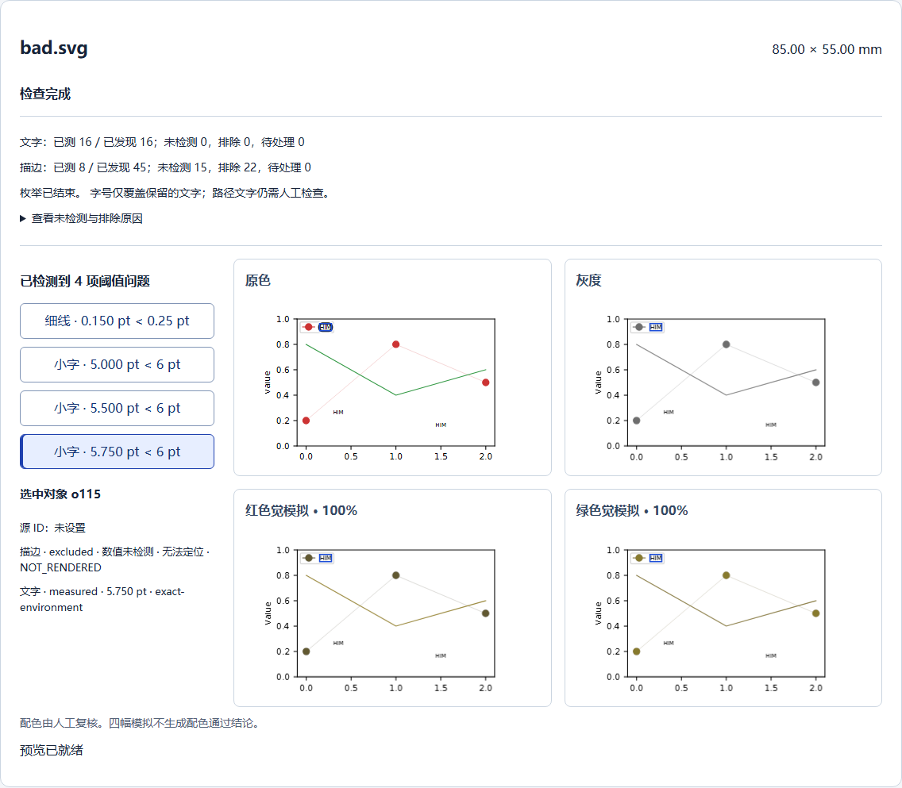

# FigurePreflight

### 在论文最终图宽下检查 SVG 图件

**检查 SVG 中保留的文字字号与描边线宽，在四幅联动预览中定位问题，并导出离线 HTML 报告与结构化 JSON。**

[English](README.md) | 中文

[本地启动](#本地启动) · [复核示例](#按-85-mm-复核示例) · [支持范围和限制](docs/support.md) · [示例 HTML](examples/bad-85mm.html) · [示例 JSON](examples/bad-85mm.json)



85 mm 合成示例的实际报告：三处小字和一条细线，四幅预览同步选中图例。

## 本地启动

使用 Node.js **24.15.0**，在项目目录运行：

```sh
npm ci
npm run build
npm run serve
```

打开 `http://127.0.0.1:48626`。服务仅监听本机回环地址，提供构建时登记的固定资产；图件留在浏览器中处理。运行已构建产物只需要 Node；Python、FontTools 和测试浏览器用于开发生成与验证。

## 按 85 mm 复核示例

1. 点击“载入 85 mm 示例”，或选择/拖入 [bad.svg](examples/bad.svg)，使用默认字号 **6 pt**、线宽 **0.25 pt**。
2. 查看三处小字和一条细线；小字中包括真实 Matplotlib 图例。点击问题或图中对象，四幅预览同步高亮。Tab 移动焦点，Enter/空格选择对象。
3. 将字号阈值改为 **5.6 pt**，剩两处小字和一条细线；这一步复用同一测量。图宽改为 **170 mm** 会重新测量并建立新 revision。
4. 恢复 **85 mm / 6 pt**，导入 [fixed.svg](examples/fixed.svg)，对应四处缺陷消失。
5. 人工比较四幅图，记录显示条件、配色判断与备注。JSON 可在测量结果生成后保存；HTML 等四幅预览就绪后保存，并可在断网浏览器中重新打开。

示例为自行生成的合成数据。在桌面默认缩放条件下，红绿系列在灰度预览中亮度接近，需要结合线型和标签区分。这是人工观察记录；工具不会自动给出“配色通过”结论。红、绿色觉模拟采用有出处的 Machado 模型，严重度为 100%；灰度按线性光亮度计算。

## 从 Matplotlib 保留文字导出

```python
import matplotlib as mpl
import matplotlib.pyplot as plt
mpl.rcParams["svg.fonttype"] = "none"
fig, ax = plt.subplots()
ax.plot([0, 1, 2], [1, 3, 2], label="HIM")
ax.legend()
fig.savefig("figure.svg", metadata={"Date": None})
```

支持配置为 `matplotlib-text-svg-v1`。转为路径的文字无法恢复字号；请先用 `svg.fonttype='none'` 导出。

## 如何理解结果

阈值问题只针对已测对象。报告分别保留已发现、已测、未检测、排除、待处理数量；运行完成不代表所有项目合格。未知滤镜等视觉能力会停用全部预览与测量，不展示缺失效果的替代“原图”。缺字体、非相似变换和未知单位等原因会保留为未检测或定位降级。

普通 DejaVu Sans 2.35 及已核字形使用同一可信字体资产，位置准确性属于记录的浏览器环境。其他字体、缺字形、非普通体保持浏览器原有回退外观，位置能力降级。HTML 的三张模拟图保存本次实际像素；原色 SVG 的回退字体在另一台机器上可能不同。Chromium 屏幕文字可使用 LCD 子像素抗锯齿，模拟栅格采用灰度抗锯齿。

## 隐私与报告

没有图件上传、账户、分析埋点、外部字体或远端图像资源。输入文件不会被覆盖；报告通过原始输入 SHA-256 关联图件。HTML 内含清理后的图件内容、可信字体、三张已保存模拟图和测量结果，应按图件内容对待。JSON 不嵌入 SVG 或完整文本，但保留文件标签、对象 ID、数值、原因和手工备注。分享前检查标签、ID 与备注是否包含个人信息。

## 开发验证

固定开发环境为 Python **3.12.14**、Matplotlib **3.9.4**、FontTools **4.66.1**，其余精确依赖及哈希在 `tools/requirements-fixtures.txt`。npm lockfile 固定 Playwright **1.58.2** 及对应浏览器版本。

Windows PowerShell：

```powershell
python -m venv .venv
.venv/Scripts/python -m pip install --require-hashes -r tools/requirements-fixtures.txt
npx playwright install chromium firefox
npm run fixtures:generate
npm run fixtures:verify
npm test
npm run build
npm run serve
```

Linux 使用 `.venv/bin/python` 与 `npx playwright install --with-deps chromium firefox`。脚本默认读取项目 venv，也可用 `FIGURE_PYTHON` 指定匹配版本的解释器。Linux CI 已配置，实际远端运行待发布阶段执行；尚未列为已验证平台。

39 张合成 SVG 覆盖 20 个主题，其中 20 张不同的已知缺陷图件用于测量验收。数值及定位采用独立 FontTools 真值，浏览器测试覆盖交互、像素、资源边界、取消与离线下载。[manifest](fixtures/manifest.json) 区分主题和测量适用样本；[逐图视觉复核](fixtures/manual-inspection.json) 记录实际检查者、浏览器与结论，不冒充用户访谈或采用研究。

贡献时提供最小合成复现、预期单位/状态，以及几何变动的独立真值。运行两个固定浏览器的测试，保留未知覆盖范围与性能限制，不将私人图件加入仓库。问题反馈注明浏览器版本与导出配置。用户访谈和采用情况仍待研究。

项目采用 MIT 许可；字体与颜色模型的独立许可见 [THIRD_PARTY_NOTICES.md](THIRD_PARTY_NOTICES.md)。

输入上限为 2 MiB、4,096 元素、4,096 原始 path 命令、每几何序列 1,024 等效命令、展开后 2,048 命令。实际 ceil 视口像素面积乘保守绘制权重不得超过 1.28 亿；超限显示 limited，缩小最终图宽可恢复预览。完整上限与回放规则见 [支持范围](docs/support.md)。
